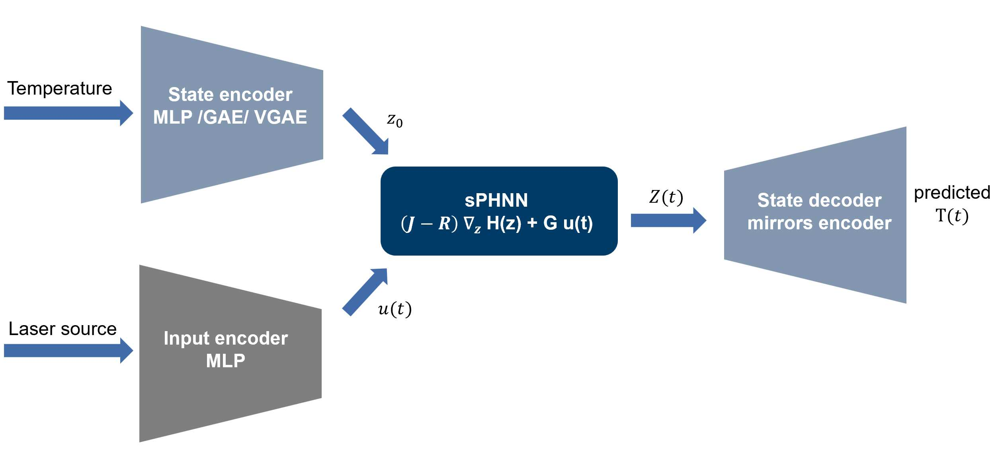
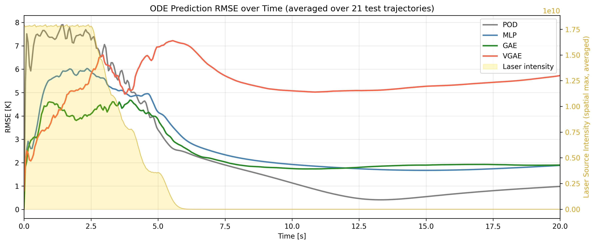

# Graph Autoencoders + Port-Hamiltonian Latent Dynamics for Thermal ROMs (DED)

Code for the paper / M.Sc. thesis

> **Graph Autoencoders with Structure-Preserving Port-Hamiltonian Latent Dynamics for Thermal Reduced-Order Modelling in Directed Energy Deposition**
> Obada Allaham, Cyber-Physical Simulation, TU Darmstadt
> Preprint: [doi.org/10.5281/zenodo.24218585](https://doi.org/10.5281/zenodo.24218585)



## What this is

A reduced-order model (ROM) for transient thermal FE simulations of Directed Energy Deposition (DED):

1. **State encoder** compresses the nodal temperature field on the unstructured FE mesh into a 16-dim latent state.
2. **Input encoder** compresses the laser heat source into an 8-dim latent input.
3. **sPHNN** (structure-preserving port-Hamiltonian neural network) integrates the latent dynamics
   `dz/dt = (J − R) ∇H(z) + G u(t)`. `J` is skew-symmetric, `R` is positive semi-definite and `H` is input-convex, so energy dissipation and Lyapunov stability hold by construction.
4. **Decoder** maps the latent trajectory back to the full temperature field.

Four compression back-ends are compared under identical dynamics model, data split and training protocol:

| Back-end | Idea |
|---|---|
| **POD** | linear SVD basis (baseline) |
| **MLP** | dense autoencoder on the flattened field |
| **GAE** | graph autoencoder: GCN layers + fixed geometric k-means pooling (1836 → 400 → 64 nodes) |
| **VGAE** | variational version of the GAE (KL-regularised latent space) |

## Results (DED, 4 training / 21 unseen test trajectories, d_latent = 16)

| Model | Trainable params | ODE test RMSE [K] (seed 42) | Worst trajectory [K] | 5-seed mean ± std [K] |
|---|---:|---:|---:|---:|
| POD  | 2,001     | 3.53 | 10.38 | 3.63 ± 0.16 |
| MLP  | 3,075,174 | 3.26 | 16.25 | 3.26 ± 0.17 |
| **GAE** | **1,317,531** | **2.81** | 10.68 | 3.31 ± 0.63 |
| VGAE | 1,911,979 | 5.50 | 19.48 | 5.18 ± 0.66 |

Main findings:
- At default settings the GAE has the lowest error with **57 % fewer parameters than the MLP**. Averaged over seeds, GAE and MLP are on par, and the GAE is more sensitive to initialisation.
- The VGAE's KL term shrinks the latent codes ~10× and hurts dynamics accuracy unless β is reduced to 1e-4 (then 2.28 K).
- POD is the most data-efficient option: with only 2 training trajectories its error roughly doubles, while the neural models degrade by ~4–5×.
- On MNIST the MLP reconstructs best, but that ranking does **not** carry over to dynamics prediction. Compression should be evaluated together with the latent dynamics model.



## Repository structure

```
DED_POD.py     POD + sPHNN
DED_MLP.py     MLP autoencoder + sPHNN
DED_GAE.py     Graph autoencoder + sPHNN
DED_VGAE.py    Variational graph autoencoder + sPHNN
MNIST_MLP.py   MNIST reconstruction benchmark (MLP)
MNIST_GAE.py   MNIST reconstruction benchmark (GAE, pixel grid as k-NN graph)
MNIST_VGAE.py  MNIST reconstruction benchmark (VGAE)
figures/       Figures used in the README / paper
```

## Installation

Python ≥ 3.11 recommended.

```bash
git clone https://github.com/Obada84/GAE_CPS.git
cd GAE_CPS
python -m venv .venv && source .venv/bin/activate   # Windows: .venv\Scripts\activate
pip install -r requirements.txt
```

For GPU support install the matching `jax[cuda]` wheel, see the [JAX installation guide](https://docs.jax.dev/en/latest/installation.html).

## Data

The DED scripts expect a folder `ded_data/` next to the scripts:

```
ded_data/
├── data.npz    # temperature (25, 401, 1836) in K and laser source (25, 401, 1836) in W/m³
└── mesh.nas    # FE mesh (Nastran), read with PyVista
```

The DED simulation data comes from the Cyber-Physical Simulation group at TU Darmstadt (see Kannapinn et al., 2024) and is **not included** in this repository. Please contact the group for access.

The MNIST scripts download MNIST automatically via `sklearn.datasets.fetch_openml`.

## Usage

```bash
# MNIST reconstruction benchmark
python MNIST_MLP.py
python MNIST_GAE.py
python MNIST_VGAE.py

# DED thermal dynamics (needs ded_data/)
python DED_POD.py
python DED_MLP.py
python DED_GAE.py
python DED_VGAE.py
```

Default hyperparameters (as in the paper): latent dim 16, Phase 1 = 10k single-step Adam steps (batch 128), Phase 2 = 4k full-trajectory steps (batch 4), learning rates 1e-3 (POD), 1e-4 (MLP), 5e-4 (GAE/VGAE), β = 1e-2 (VGAE).

Rough training times on the thesis setup: POD ~40 min, MLP ~60 min, GAE/VGAE ~500 min (dense adjacency multiplications).

## Built on

- [JAX](https://github.com/jax-ml/jax), [Equinox](https://github.com/patrick-kidger/equinox), [Optax](https://github.com/google-deepmind/optax), [Diffrax](https://github.com/patrick-kidger/diffrax), [klax](https://pypi.org/project/klax/)
- [dynax](https://github.com/Drenderer/dynax) for the port-Hamiltonian model, ODE solver and POD latent space
- Stable port-Hamiltonian neural networks: Roth et al., arXiv:2502.02480

## Citation

```bibtex
@misc{allaham2026gaesphnn,
  title  = {Graph Autoencoders with Structure-Preserving Port-Hamiltonian Latent Dynamics
            for Thermal Reduced-Order Modelling in Directed Energy Deposition},
  author = {Allaham, Obada},
  year   = {2026},
  note   = {Preprint}
}
```

## Acknowledgements

This work is based on my M.Sc. thesis at the Chair of Cyber-Physical Simulation, TU Darmstadt, supervised by Dr.-Ing. Dominik Klein and M.Sc. Fabian Roth.
